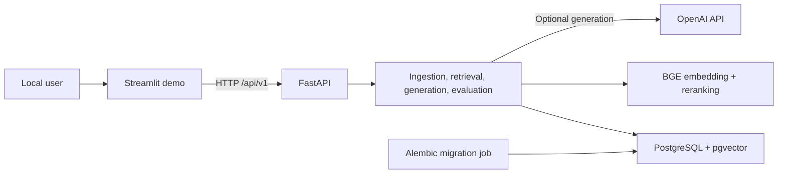

# Financial RAG Platform

[](https://github.com/ntheofan/financial-rag-platform/actions/workflows/ci.yml)
[](https://www.python.org/)
[](LICENSE)

A local financial-document intelligence platform for asking grounded questions,
inspecting evidence, comparing retrieval strategies, and running reproducible
retrieval evaluations.

> **Status: in development.** This is a tested, single-user portfolio demo—not
> a deployed production service or a published FinanceBench benchmark.

## What it demonstrates

- Local PDF, Markdown, and text ingestion with metadata lineage.
- Markdown-aware chunking using the thesis defaults: 1,500 characters and 200
  characters overlap.
- Dense retrieval with BAAI/bge-m3 and FAISS `IndexFlatIP`.
- Hybrid retrieval with BM25 and weighted Reciprocal Rank Fusion.
- Optional reranking with BAAI/bge-reranker-v2-m3.
- Grounded OpenAI generation with validated citations and abstention behavior.
- PostgreSQL/pgvector persistence with immutable corpus and index revisions.
- A FastAPI backend and a Streamlit interface that communicates only through
  the API.
- Paired Hit@K and MRR evaluation across all three retrieval modes.

The application keeps its business logic in explicit, typed services. LangChain
is used for document and text-splitting primitives rather than opaque chains.

## Demo workflow

The Streamlit demo exposes five focused views:

1. **Documents** — upload a local document, build a corpus/index revision, and
   activate it.
2. **Ask** — submit a question and inspect the grounded answer, citations,
   source metadata, and retrieval score trace.
3. **Compare retrieval** — run the same query through Dense, Hybrid, and Hybrid
   + Reranker.
4. **Evaluate** — run a small compatible JSON/JSONL benchmark and compare Hit@K
   and MRR by mode.
5. **Current scope** — review the implemented boundaries and limitations.

A cleared synthetic filing is included at
[`tests/fixtures/demo/acme-2025-10k.md`](tests/fixtures/demo/acme-2025-10k.md),
with a matching synthetic retrieval benchmark at
[`tests/fixtures/demo/acme-benchmark.json`](tests/fixtures/demo/acme-benchmark.json),
so the full demo does not require publishing a real financial filing or
benchmark row.

## Architecture



Streamlit is a typed HTTP client and receives no provider or database secrets.
FastAPI owns validation and service composition; PostgreSQL/pgvector owns
revision persistence. See [the architecture notes](docs/architecture.md) for
the complete trust and data boundaries.

## Retrieval modes

| Mode | Pipeline |
| --- | --- |
| `dense` | BGE-M3 query embedding → normalized inner-product search |
| `hybrid` | Dense + BM25 → weighted Reciprocal Rank Fusion |
| `hybrid_reranked` | Hybrid candidates → BGE cross-encoder reranking |

The corrected comparison protocol is versioned as `platform_v1`. Historical
thesis results remain identified separately as `research_legacy_v1`; they are
not presented as new benchmark results.

## Quick start with Docker

Prerequisites: Docker Engine/Desktop with Compose v2. The model-enabled API
image is CPU-only. Its first run may download BGE model weights into an ignored
Docker volume.

```powershell
Copy-Item .env.example .env
docker compose up --build --wait
```

Then open:

- Streamlit: <http://127.0.0.1:8501>
- FastAPI documentation: <http://127.0.0.1:8000/docs>

`OPENAI_API_KEY` is optional and belongs only in the ignored `.env`. Without a
key, document ingestion, retrieval comparison, and retrieval evaluation remain
usable; grounded answer generation reports unavailable instead of making a
request.

To stop the stack while retaining the local database and model cache:

```powershell
docker compose down
```

Detailed startup, migration, port override, and cleanup guidance is in
[docs/container-runtime.md](docs/container-runtime.md).

## Local development

On Windows PowerShell with Python 3.12:

```powershell
py -3.12 -m venv .venv
.\.venv\Scripts\python.exe -m pip install --upgrade pip
.\.venv\Scripts\python.exe -m pip install -e ".[demo,dev,security]"
.\.venv\Scripts\ruff.exe check .
.\.venv\Scripts\ruff.exe format --check .
.\.venv\Scripts\mypy.exe src tests
.\.venv\Scripts\pytest.exe --cov=financial_rag --cov-report=term-missing -q
```

Automated tests use synthetic fixtures and fake providers. They do not make
live OpenAI or model-network calls. PostgreSQL integration is opt-in when a test
database URL is explicitly supplied.

## Verified baseline

The public `v0.1.0` release candidate was checked with:

- 237 passing tests, 1 opt-in PostgreSQL test skipped, and 87% combined branch
  coverage;
- Ruff formatting/linting and strict mypy across 146 source files;
- a clean PostgreSQL/pgvector migration and integration smoke test;
- a clean Docker Compose acceptance run covering ingestion through all three
  retrieval modes, grounded generation with a citation, and paired evaluation;
- a publication scanner, exact-commit repository gate, and immutable notebook
  hash check;
- a strict dependency audit reporting no known vulnerabilities at the time of
  the check.

These results are engineering evidence for the checked synthetic workflow—not
claims of financial correctness, benchmark superiority, production readiness,
or permanent security.

## Data and publication policy

The public repository intentionally excludes source PDFs, FinanceBench data,
parsed or cleaned full text, chunks, embeddings, indexes, generated contexts,
local databases, model caches, `.env`, and the 15 thesis notebooks.

The notebooks are retained byte-for-byte in the local research workspace and
protected by a hash gate. FinanceBench and third-party documents are governed
separately from the MIT-licensed project code. See
[DATA_LICENSE.md](DATA_LICENSE.md) and
[docs/publication-policy.md](docs/publication-policy.md).

## Current limitations

- Local, single-user workflow only; no authentication or tenant isolation.
- In-process document jobs are not resumable or suitable for public uploads.
- PDF extraction is text-only: there is no OCR or complete table-fidelity claim.
- No public deployment, managed storage, distributed workers, monitoring/SLOs,
  or scaling claim.
- No FinanceBench artifacts or newly published benchmark scores are bundled.

## Documentation

- [Recruiter demo walkthrough](docs/recruiter-demo.md)
- [Container runtime](docs/container-runtime.md)
- [Local acceptance](docs/local-acceptance.md)
- [Retrieval design](docs/retrieval-design.md)
- [Evaluation protocol](docs/evaluation.md)
- [Publication policy](docs/publication-policy.md)
- [Notebook migration audit](docs/notebook-migration-audit.md)
- [v0.1.0 release notes](docs/release-notes-v0.1.0.md)
- [Phase 14 release-candidate report](docs/phase-14-report.md)
- [Phase 13 hosted CI report](docs/phase-13-report.md)
- [Changelog](CHANGELOG.md)

## License

Original project code is available under the [MIT License](LICENSE). Dataset
and document licensing is described separately in
[DATA_LICENSE.md](DATA_LICENSE.md).
