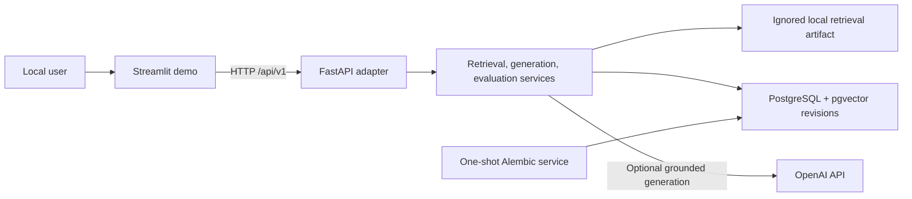

# Architecture

`financial-rag-platform` is a local, single-user demonstration system. Its
boundaries are explicit: Streamlit is an HTTP client, FastAPI composes tested
application services, and PostgreSQL/pgvector owns revision persistence. Local
retrieval artifacts remain a separate, ignored input until the database-backed
query path is implemented.

## Trust and data boundaries

- The browser-facing demo receives no provider or database credentials.
- FastAPI is the only application boundary used by Streamlit.
- OpenAI access is optional and configured only in the API process.
- The Compose database port is bound to loopback for local inspection.
- Source documents, parsed text, chunks, vectors, indexes, evaluation runs,
  database volumes, and model caches are never Docker build inputs.
- The model-enabled API image contains Python model libraries, not downloaded
  model weights. Weights use an ignored Docker named volume at runtime.
- API and demo containers run as UID/GID `10001`, with read-only root
  filesystems and temporary writable `/tmp` mounts.

## Honest capability boundary

Starting the stack without a compatible retrieval artifact provides liveness,
OpenAPI, database migration, and infrastructure-smoke behavior. Retrieval,
comparison, grounded generation, and evaluation become ready only when a
compatible ignored artifact is explicitly mounted and configured. Generation
also requires a local `.env` containing `OPENAI_API_KEY`.

The bounded Phase 9 upload lifecycle is local-only and stages documents outside
the image before persisting chunks/vectors in the local database. The stack is
not approved for public deployment. It has no authentication,
authorization, tenant isolation, quotas, TLS termination, upload lifecycle,
durable external workers, or managed secret/storage controls.
